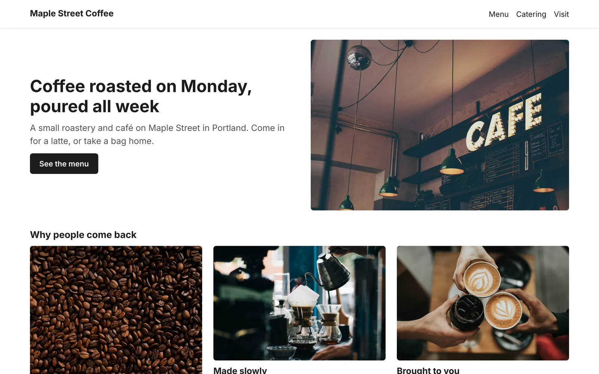
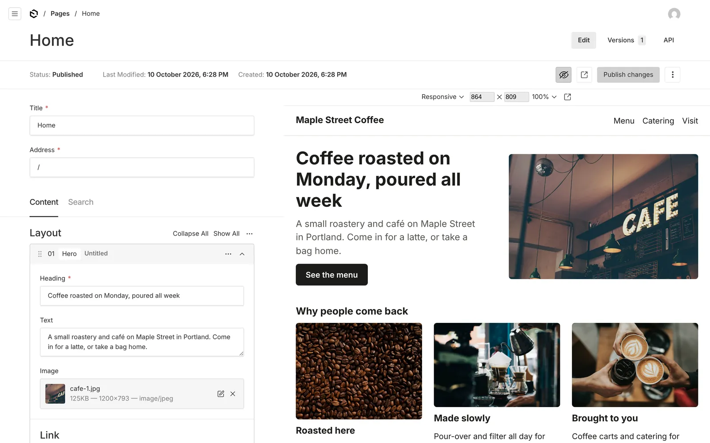
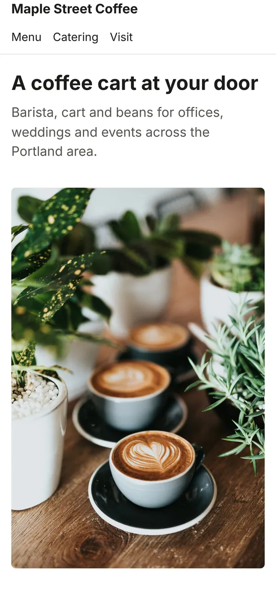

<p align="center">
  <a href="https://whisk.run">
    <picture>
      <source media="(prefers-color-scheme: dark)" srcset="https://github.com/whisk-hosting/cli/raw/main/.github/whisk-wordmark-light-ink.svg">
      
    </picture>
  </a>
</p>

<h1 align="center">Website</h1>

<p align="center">
  <strong>A business website with its own editor, live on Whisk from one prompt.</strong>
</p>

<p align="center">
  
  
  
  
</p>

<p align="center">
  <a href="#put-it-live">Put it live</a> ·
  <a href="#what-you-get">What you get</a> ·
  <a href="#make-it-yours">Make it yours</a> ·
  <a href="#what-whisk-is">What Whisk is</a> ·
  <a href="#how-it-works">How it works</a>
</p>

<p align="center">
  
</p>

## Put it live

Give your coding agent (Claude Code, Codex, Cursor, Gemini CLI or any other) this prompt:

> Read https://whisk.run/skill and install the Whisk CLI. Then, in a new empty folder, run
> `whisk init --template site` and `whisk deploy`, and give me the address the website is live
> at and the address of its editor.

Or run it yourself:

```sh
curl -fsSL https://github.com/Whisk-Hosting/cli/releases/latest/download/install.sh | sh     # Windows: irm https://github.com/Whisk-Hosting/cli/releases/latest/download/install.ps1 | iex
mkdir my-website && cd my-website
whisk login
whisk init --template site
whisk deploy
```

The website is live at `https://<app>--<business>.whisk.page` with a home page to change. Open
`/app` on it and sign in with your Whisk account to edit. It runs on any paid Whisk plan (it
needs about 300 MB of memory); the free app is too small for it.

## What you get

<p align="center">
  
</p>

- **An editor for the whole team** at `/app`. Everyone in the business signs in with their Whisk
  account, so there are no passwords to share and nobody to add twice.
- **A dashboard** the editor opens on: pages, enquiries and pictures at a glance, the latest
  enquiries, and every page with when and by whom it last changed, a step from editing.
- **Enquiries** from the site's forms in the editor, each opening to all it said, with Reply by
  email and Call.
- **Pages built from blocks**: hero, text, picture, columns, list, form and HTML, in any order,
  at any address.
- **Shared lists** edited once and shown on any page: testimonials, people, questions, locations
  and logos, each in the order you drag it to.
- **A live preview** beside the editor that follows each change, drafts only the team can see,
  and every earlier version kept.
- **Menus, footer and site name** edited in the same place.
- **Forms** that save each entry in the website's own database, behind a bot check.
- **Search engines covered**: a title and description for each page, `sitemap.xml`,
  `robots.txt`, and old addresses sent to new ones in one hop.
- **Fast on a phone**: pages drawn on the server, fonts cut to the letters used, WebP pictures,
  Brotli text, and pages cached at the edge for five minutes.
- **Hosting handled by Whisk**: HTTPS, your own domain, nightly backups, logs and a move to
  another server by itself if one fails.
- **Ready to sell later**: the editor is the same as the [Whisk shop](https://github.com/whisk-hosting/shop)'s,
  file for file, so a website that starts selling becomes a shop and keeps every page, menu and
  picture.

<p align="center">
  
</p>

## Make it yours

The live website is a plain, tidy start. Ask your agent for the rest, in the same folder:

> Restyle this website for my business, Maple Street Coffee, a café and roastery in Portland. Use
> warm colors and a serif for headings, add Menu, Catering and Visit pages with a catering enquiry
> form, then deploy it.

> Add a "Team" block with a photo, name and role for each person, so we can add people in the
> editor, then deploy it.

> Point www.example.com at this website.

Words, pictures and pages are changed in the editor by anyone on the team; the look and new kinds
of blocks are changed in the code, by the agent.

## What Whisk is

[Whisk](https://whisk.run) is hosting for business apps and websites built by AI coding agents.
The agent installs the `whisk` CLI, describes the app in `whisk.yaml` and runs `whisk deploy`;
Whisk supplies sign-in, a Postgres database, backups, storage, email, scheduled jobs and
security, so the agent writes only the app. This website is one of its starting points, with the
[shop](https://github.com/whisk-hosting/shop) and the starter apps in the
[CLI](https://github.com/whisk-hosting/cli).

## How it works

A business's website on Whisk, headless, in one app on one address. A small Go server draws every
page from Whisk's content engine, which holds the pages, the menus and the pictures in the app's
own database and answers the editor at `/cms` and its API at `/cms/api` in
[Payload](https://payloadcms.com)'s shape. On Whisk's machines the engine answers the site
itself; in a preview or on a laptop the server starts it beside the pages. The business's Whisk
team edits the site at `/app` with their Whisk sign-in; nobody has a password. It needs about
40 MB of memory.

A page is a list of blocks (hero, text, picture, columns, list, form, HTML) at an address; a list
block shows one of the shared lists: all of it, a topic of it, or the entries picked. Rich text
holds pictures, with a caption, and callouts (a note, tip or warning) where they go in the words,
and an agent may send it as HTML (`{"html": "…"}`). Drafts are
seen only by the team, in a preview beside the editor that follows the edit. A form block posts
to `/forms/<name>`, kept in the database's `form_entries` table. The editor lists them under
Enquiries, with times in `SITE_TIME_ZONE` (an IANA zone such as `Pacific/Auckland`, set in
`whisk.yaml`'s `env`; UTC when unset). A coding agent edits the pages
through the API at `/cms/api` on the site's address, with its Whisk credential
(`Authorization: Bearer $WHISK_TOKEN`), as the person it works for; each version of a page
records who made it, as "Claude for Jane Doe" for an agent's change. Old addresses go in
`redirects.json` (`{"from": "/old", "to": "/new"}`, or `"status": 410` for a page that is gone),
other sitemap addresses in `sitemaps.json` (`["/sitemap_index.xml"]`), and a `robots.txt` beside
`whisk.yaml` is served as it is. Starting content goes in `content/` (`content/README.md` says how) and is added once, never
over an edit.

The look is `theme/`, plain HTML with Go's template tags: the frame and every page
(`theme/site.html`), one file per block (`theme/blocks/<block>.html`), the not-found page
(`theme/404.html`) and `theme/site.css`, which goes inline in every page. A block's file reads the
block's fields as `.B.<field>` and draws a picture with `{{img .B.image 720 .First ""}}`. Add a
block of the site's own with two files of the same name: its fields in `content/blocks/<slug>.json`
(`{"label": "Pricing table", "fields": [{"name": "heading", "type": "text", "label": "Heading"}]}`;
the types are text, textarea, words, picture, check, number, select, link, group and rows), which
the editor builds its form from, and its look in `theme/blocks/<slug>.html`. Files in `public/` are
served as they are. The server's own code (`*.go`) rarely needs a change.

```
main.go                     the server: health, forms, the admin, the editor, redirects, files,
                            pages, and the migrate step (form_entries)
route.go                    what the server decides about each request
content.go                  reading pages and menus from the engine's API, kept for when it restarts
render.go                   drawing pages from theme/
editor.go                   starts the content engine beside the server off Whisk's machines and
                            passes /cms to it
theme/                      every page: the frame, the blocks, the look
content/                    starting content and the site's own blocks
public/                     files served as they are: the favicon, the form and preview scripts
scripts/site.mjs            build, files, dev
scripts/optimise.mjs        fonts cut to the letters used, WebP pictures, Brotli and gzip copies, kept between builds
```

### Run it on your computer

`whisk dev` needs Docker with the compose plugin. It starts Postgres and a local edge, downloads
Whisk's content engine, then runs the site with the environment it has in production:

```
npm install
npm run build
whisk dev --as you@example.com --roles owner -- npm run start
```

These lines work the same in PowerShell, Command Prompt and a Unix shell. `whisk dev` runs the
migrate step (`./server migrate`) first. Open http://127.0.0.1:3000 for the site and
http://127.0.0.1:3000/app for the editor. It needs Go 1.26 or later. `npm run dev` instead reads
the theme again on every page.

### Check it

```
npm test
npm run typecheck
```

## Licence

MIT. The photographs in the screenshots are from [Unsplash](https://unsplash.com), and Maple
Street Coffee is made up.
